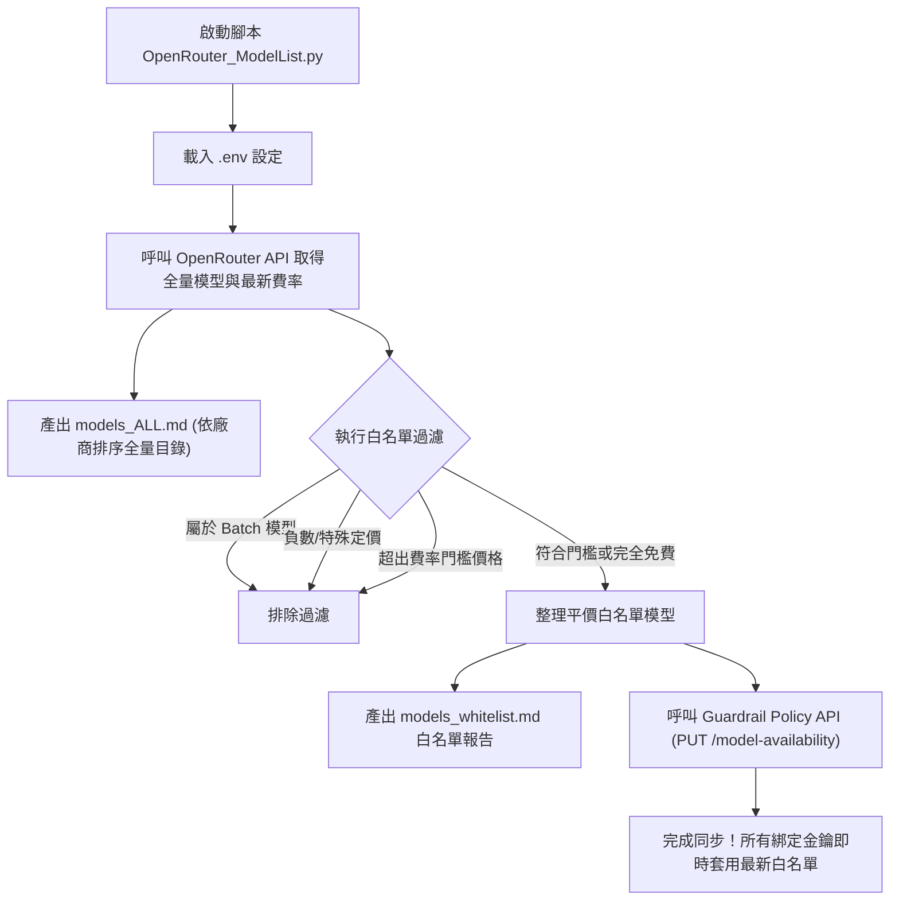

# OpenRouter Guardrail 同步與模型費率篩選工具 (OpenRouter Guardrail Sync)

本工具專為 OpenRouter 使用者設計，能自動抓取 OpenRouter 官方最新的模型價目清單，依據使用者自訂的預算費率門檻（每百萬 Token 輸入與輸出單價上限）篩選出平價與完全免費的模型，自動生成全量模型目錄報表（`models_ALL.md`）與篩選後的白名單報表（`models_whitelist.md`），並透過 OpenRouter 最新 Guardrail Policies 管理 API 將符合條件的模型同步寫入指定的 `Model & provider access` 策略白名單中，避免 API 金鑰因誤呼叫高資費或 Batch 非同步模型而導致非預期花費。

---

## 核心功能特色

- **雙報表輸出**：
  - **`models_ALL.md`**：匯出 OpenRouter 全量模型清單，強制依據「廠商 (Provider)」字母順序分組排序，一覽各大供應商模型規格與計費。
  - **`models_whitelist.md`**：精準列出通過費率門檻篩選的白名單模型。
- **智慧排除非即時與特殊模型**：
  - **自動排除 Batch 模型**：全面剃除所有非同步 `:batch` 模型，確保推論 API 金鑰僅能調用即時互動模型。
  - **自動排除負數費率與特殊路由**：防止特殊動態計費模型（如 Auto Router 等）誤入白名單。
- **優先採用官方正式快照 Slug (Canonical Slug)**：
  - 精準採用 OpenRouter 官方正式快照版本（如 `google/gemma-4-26b-a4b-it-20260403`），維持 1:1 純淨對應，絕不虛胖重複。
  - 避免通用別名在後台被誤判為未辨識原始字串而殘留 `⚠️` 警告標籤，確保後台顯示乾淨俐落。
- **支援免費模型**：自動保留所有費率為 0 的免費模型（Free Tier）。
- **原生適配 OpenRouter 最新 Guardrail 架構**：
  - 專為 OpenRouter 新版三分類體系中的 **`Model & provider access`** 策略打造。
  - 採用官方標準 `PUT` 請求更新 `guardrails/policies/model-availability` 端點，精準可靠。
- **提供 CLI 政策查詢指令**：支援執行 `python OpenRouter_ModelList.py --list` 快速列出帳號下所有 Policy 名稱與 ID。

---

## 運作架構流程



---

## 目錄結構

```text
├── .env.example              # 環境變數設定範本檔
├── .gitignore                # Git 忽略設定（保護敏感金鑰與產出檔案）
├── OpenRouter_ModelList.py   # 核心同步、查詢與篩選腳本
├── README.md                 # 專案詳細說明文件
├── models_ALL.md             # 全量模型目錄（依廠商排序，已由 .gitignore 忽略）
└── models_whitelist.md       # 平價白名單表格（已由 .gitignore 忽略）
```

---

## 環境需求與套件安裝

- **Python**：3.10 或更新版本
- **相依套件**：
  - `requests`：處理 OpenRouter API 連線與 PUT/PATCH 請求
  - `python-dotenv`：讀取 `.env` 環境變數

安裝指令：
```bash
pip install requests python-dotenv
```

---

## 快速上手步驟

### 1. 配置環境變數

請複製目錄下的範本檔 `.env.example` 為 `.env`：

在 Windows 命令提示字元 / PowerShell：
```cmd
copy .env.example .env
```

或在 Bash 環境：
```bash
cp .env.example .env
```

### 2. 於 OpenRouter 後台建立 Guardrail 策略

OpenRouter 最新介面將 Guardrails 拆分為三大獨立類型：
1. **Budget**（預算上限）
2. **Model & provider access**（模型與供應商存取限制）★ **請選此項**
3. **Content moderation**（內容安全審查）

操作步驟：
1. 進入 OpenRouter 後台 `Guardrails` 頁面，點擊 **`New guardrail`**。
2. 在第 1 步 **Choose type** 選擇 **`Model & provider access`**，點擊 `Continue`。
3. 在第 2 步 **Configure** 輸入名稱（例如 `Low-Cost Whitelist`），底下的模型白名單可留空，點擊 `Continue`。
4. 在第 3 步 **Assign** 指派給欲限制的 API Key 或 Workspace 預設，點擊建立完成。
5. 建立後點入該策略詳情頁，查看瀏覽器網址末端即可取得 Policy ID：
   ```text
   https://openrouter.ai/workspaces/default/guardrails/policies/model-availability/[POLICY_ID]
   ```

### 3. 編輯 `.env` 設定檔

填入您的 Management Key、剛取得的 Policy ID 以及費率門檻：

```env
# 1. 具備 Management 權限的管理專用 API Key
OPENROUTER_MANAGEMENT_KEY=your_openrouter_management_key_here

# 2. 目標 Model & provider access 政策 ID
OPENROUTER_GUARDRAIL_ID=your_model_availability_policy_id_here

# 3. 費率門檻 (單位：美元 / 每百萬 Token)
MAX_INPUT_PRICE_PER_M=0.25
MAX_OUTPUT_PRICE_PER_M=0.50
```

> [!TIP]
> 若忘記或不確定 Policy ID，可直接執行查詢指令查看：
> ```bash
> python OpenRouter_ModelList.py --list
> ```

### 4. 執行同步腳本

在專案目錄下執行：
```bash
python OpenRouter_ModelList.py
```

### 5. 檢視執行成果

1. **終端機輸出**：顯示全量模型數、白名單符合總數，以及 API 同步狀態。
2. **`models_ALL.md`**：查看 OpenRouter 上所有廠商的模型總表。
3. **`models_whitelist.md`**：檢視目前已自動寫入 Guardrail 白名單的平價即時模型。

---

## 產出報表說明

### 1. 全量模型清單 (`models_ALL.md`)
依照廠商名稱字母順序分組排列，欄位包含：
- **廠商 (Provider)**：模型所屬供應商（例如 `google`, `anthropic`, `openai`, `deepseek` 等）。
- **模型名稱 / 模型 ID**：完整名稱與呼叫標籤。
- **Context 視窗**：上下文視窗長度。
- **Input / Output 單價**：每百萬 Token 費率。
- **類型與備註**：標記是否為免費模型、Batch 模型或特殊定價。

### 2. 白名單模型清單 (`models_whitelist.md`)
僅收錄符合費率上限的即時推論模型，自動剃除 Batch 與負數費率，供使用者比對受限金鑰實際可呼叫的模型。

---

## 重要注意事項：官方正式快照版 (Canonical Slug) 單一精準同步機制

在 OpenRouter 後台設定 Guardrail 白名單時，常會發現部分手動或 API 加入的模型前面亮起黃色三角形驚嘆號（`⚠️`），這通常不是模型失效或達到數量上限，而是 OpenRouter 前後端的識別機制所致：

1. **識別碼結構差異**：
   - **通用別名 (Generic ID)**：如 `google/gemma-4-26b-a4b-it`。
   - **官方正式快照版 (Canonical Slug)**：如 `google/gemma-4-26b-a4b-it-20260403`。
2. **為什麼不宜同時塞入通用別名？**：
   - OpenRouter 網頁前台的 Logo 與正式名稱渲染元件庫，僅能精確匹配帶有版本後綴的 `canonical_slug`。
   - 若將通用別名一併寫入，OpenRouter 後端並不會自動將兩者合併為同一個項目，而是將通用別名獨立視為未識別字串並打上 `⚠️` 警告留存，導致白名單數量虛胖翻倍（例如從 98 款變成 156 個），且畫面上充斥驚嘆號。
3. **本腳本的精準處理原則**：
   - 腳本在同步時會**優先採用官方正式快照版 (`canonical_slug`)**，若無快照版才使用通用 ID。
   - **維持 1:1 純淨對應**：符合費率門檻的平價模型有幾款就精準同步幾款，數量絕不虛胖重複。
   - **徹底消除通用別名驚嘆號**：避免未辨識的通用別名字串在後台殘留。
4. **免費模型 (`:free`) 快照命名規則與自動合成防呆**：
   - 在 OpenRouter 系統中，免費模型的官方快照真實格式為 **`canonical_slug + ":free"`**（例如 `cohere/north-mini-code-20260617:free` 或 `google/gemma-4-26b-a4b-it-20260403:free`）。
   - 若僅傳送通用的 `id`（如 `cohere/north-mini-code:free`），後台 UI 會因缺少版本日期而當作未識別字串；若僅傳送基礎 `canonical_slug`（如 `cohere/north-mini-code-20260617`），後台又會因漏了 `:free` 而試圖比對不存在的收費端點。兩者都會導致後台亮起 `⚠️` 警告！
   - **防呆實作**：本腳本的 `resolve_model_slug` 函式具備自動快照合成邏輯——當模型為免費版 (`:free`) 時，自動將官方快照版結尾補齊 `:free`，完美同時滿足「版本快照」與「免費變體」，徹底消除所有免費模型的驚嘆號！

---

## 資安與維護規範

1. **防範金鑰外洩**：本專案已在 `.gitignore` 中排除 `.env`，嚴禁將含有真實 Management Key 的設定檔提交至版本控制。
2. **定期同步**：OpenRouter 模型與價格會持續更新，建議可定期執行此工具，確保白名單持續涵蓋最新發布的平價即時模型。
