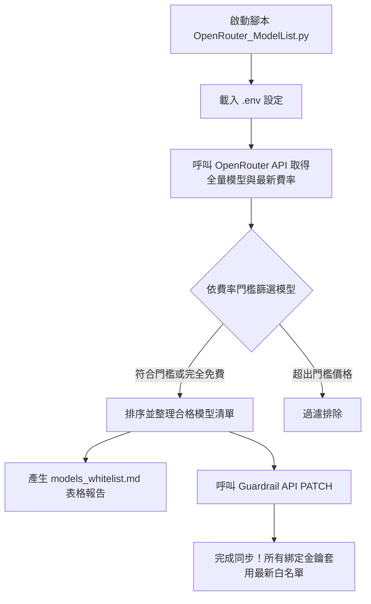

# OpenRouter Guardrail 同步與模型費率篩選工具 (OpenRouter Guardrail Sync)

本工具專為 OpenRouter 使用者設計，能自動抓取 OpenRouter 官方最新的模型價目清單，依據使用者自訂的預算費率門檻（每百萬 Token 輸入與輸出單價上限）篩選出平價與完全免費的模型，自動生成美觀的 Markdown 報告，並透過 OpenRouter 管理 API 將符合條件的模型同步寫入指定的 Guardrail 白名單中，避免 API 金鑰因誤呼叫高資費模型而導致預算超支。

---

## 核心功能特色

- **自動化費用防護**：設定每百萬 Token 單價上限，自動排除超出預算的昂貴模型。
- **支援免費模型**：自動保留所有費率為 0 的免費模型（Free Tier）。
- **生成 Markdown 報表**：自動產出包含模型名稱、ID、Context 長度、計費單價與免費標籤的完整對照表（`models_whitelist.md`）。
- **Guardrail 一鍵同步**：透過 OpenRouter PATCH API 自動更新白名單，下游所有綁定該 Guardrail 的 API 金鑰立即受限生效。

---

## 運作架構流程



---

## 目錄結構

```text
├── .env.example              # 環境變數設定範本檔
├── .gitignore                # Git 忽略設定（保護敏感金鑰與產出）
├── OpenRouter_ModelList.py   # 核心同步與篩選腳本
├── README.md                 # 專案詳細說明文件
└── models_whitelist.md       # 腳本執行產出的模型白名單表格（已由 .gitignore 忽略）
```

---

## 環境需求與套件安裝

- **Python**：3.10 或更新版本
- **相依套件**：
  - `requests`：處理 OpenRouter API 連線與 PATCH 請求
  - `python-dotenv`：讀取 `.env` 環境變數

安裝指令：
```bash
pip install requests python-dotenv
```

---

## 快速上手步驟

### 1. 複製並配置環境變數

請複製目錄下的範本檔 `.env.example` 為 `.env`：

在 Windows 命令提示字元 / PowerShell：
```cmd
copy .env.example .env
```

或在 Bash 環境：
```bash
cp .env.example .env
```

### 2. 編輯 `.env` 設定檔

使用編輯器開啟 `.env`，填入您的專屬認證資訊與費率門檻：

```env
# 1. 具備 Provisioning / Management 權限的管理專用 API Key
OPENROUTER_MANAGEMENT_KEY=your_openrouter_management_key_here

# 2. 要維護的目標 Guardrail ID
OPENROUTER_GUARDRAIL_ID=your_guardrail_id_here

# 3. 費率門檻 (單位：美元 / 每百萬 Token)
# 範例：Input 每百萬 Token 不超過 0.25 美元，Output 每百萬 Token 不超過 0.5 美元
MAX_INPUT_PRICE_PER_M=0.25
MAX_OUTPUT_PRICE_PER_M=0.50
```

> [!IMPORTANT]
> **金鑰權限提醒**：
> `OPENROUTER_MANAGEMENT_KEY` 必須具備 Management / Guardrail 修改權限，一般的對話推論 API Key 無法執行 PATCH 更新。

### 3. 執行同步腳本

在專案目錄下執行：
```bash
python OpenRouter_ModelList.py
```

### 4. 檢視執行成果

1. **終端機輸出**：將顯示撈取到的符合模型總數，以及 Guardrail API 的更新狀態。
2. **輸出報告**：專案根目錄將產生或覆寫 `models_whitelist.md`，可檢視所有目前列入白名單的模型清單與規格。

---

## 產出報告欄位說明 (`models_whitelist.md`)

產出的表格範例格式如下：

| 欄位名稱 | 說明 |
| :--- | :--- |
| **模型名稱** | 該模型在 OpenRouter 上的顯示名稱 |
| **模型 ID** | 呼叫 API 時使用的完整模型 ID（如 `google/gemini-2.5-flash`） |
| **Context 視窗** | 模型的上下文長度（例如 1000k 代表 100 萬 Token 上下文） |
| **Input 單價** | 每百萬輸入 Token 費用（美元，四捨五入至小數點後四位） |
| **Output 單價** | 每百萬輸出 Token 費用（美元，四捨五入至小數點後四位） |
| **類型** | 標記為「免費 (Free)」或「平價」 |

---

## 資安與維護規範

1. **防範金鑰外洩**：本專案已在 `.gitignore` 中設定忽略 `.env`，嚴禁將包含實際金鑰的檔案提交至遠端儲存庫。
2. **週期性同步**：OpenRouter 上的模型與費率會動態調整，建議可定期執行本腳本，或透過定時工作（如 GitHub Actions、排程任務）確保 Guardrail 隨時保有最新且成本受控的模型。
